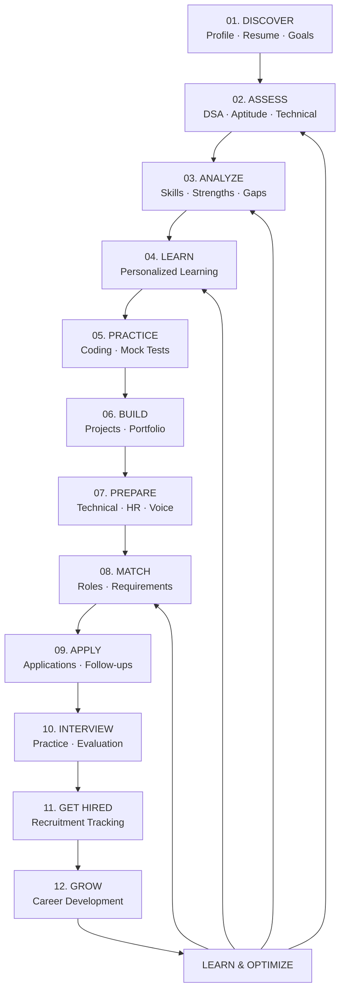
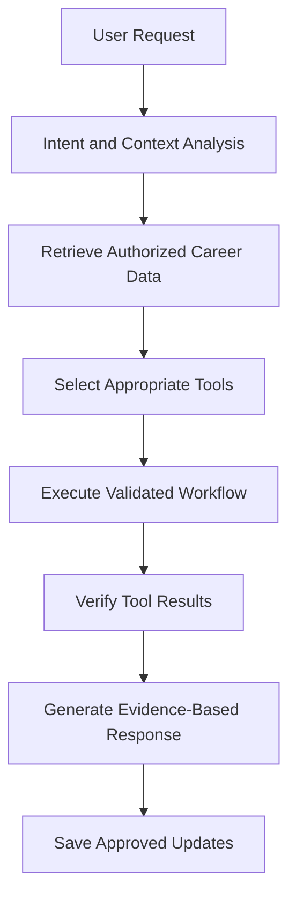
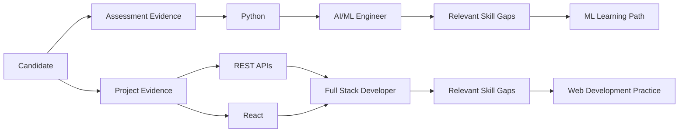
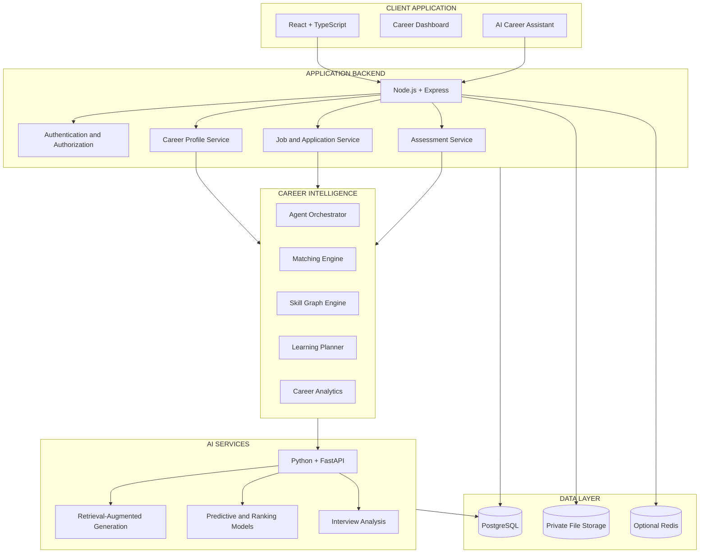
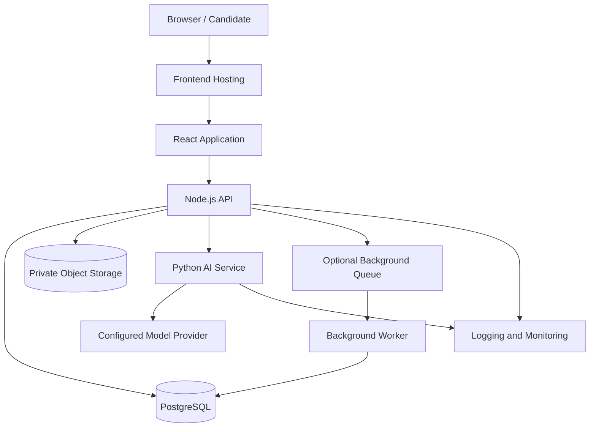

# 🚀 CareerPilot AI

<div align="center">

# 🎯 CareerPilot AI

### Personal AI Career Intelligence & Placement Operating System

**Discover → Assess → Analyze → Learn → Practice → Build → Prepare → Match → Apply → Interview → Get Hired → Grow**

<p>
  
  
  
  
</p>

<p>
  
  
  
  
  
  
</p>

**One candidate. One evolving intelligence profile. One connected career journey.**

</div>

---

# 🧭 Table of Contents

- [Overview](#-overview)
- [Problem Statement](#-problem-statement)
- [Vision and Philosophy](#-vision-and-philosophy)
- [Core Intelligence Loop](#-core-intelligence-loop)
- [Key Features](#-key-features)
- [Career Intelligence Engine](#-career-intelligence-engine)
- [Personal AI Career Agent](#-personal-ai-career-agent)
- [Career Digital Twin](#-career-digital-twin)
- [Skill Intelligence Graph](#-skill-intelligence-graph)
- [Career Discovery](#-career-discovery)
- [Skill Gap Analysis](#-skill-gap-analysis)
- [AI Learning Engine](#-ai-learning-engine)
- [DSA Intelligence](#-dsa-intelligence)
- [Coding Intelligence](#-coding-intelligence)
- [Aptitude Intelligence](#-aptitude-intelligence)
- [Adaptive Assessment](#-adaptive-assessment)
- [AI Interview Simulator](#-ai-interview-simulator)
- [Voice Interview Coach](#-voice-interview-coach)
- [AI Project Builder](#-ai-project-builder)
- [GitHub Intelligence](#-github-intelligence)
- [Resume Intelligence](#-resume-intelligence)
- [Job Matching](#-job-matching)
- [Application Intelligence](#-application-intelligence)
- [Company Intelligence](#-company-intelligence)
- [Placement Intelligence](#-placement-intelligence)
- [Career What-If Simulator](#-career-what-if-simulator)
- [Career Analytics](#-career-analytics)
- [AI Daily Planner](#-ai-daily-planner)
- [System Architecture](#-system-architecture)
- [AI Intelligence Architecture](#-ai-intelligence-architecture)
- [End-to-End Data Flow](#-end-to-end-data-flow)
- [Technology Stack](#-technology-stack)
- [Project Structure](#-project-structure)
- [Database Design](#-database-design)
- [API Architecture](#-api-architecture)
- [Security and Privacy](#-security-and-privacy)
- [Testing Strategy](#-testing-strategy)
- [Deployment Architecture](#-deployment-architecture)
- [Development Roadmap](#-development-roadmap)
- [Future Vision](#-future-vision)
- [Contributing](#-contributing)
- [License](#-license)

---

# 🚀 Overview

**CareerPilot AI** is an AI-powered personal career intelligence and placement operating system designed to connect the entire career-development lifecycle, from discovering career opportunities to demonstrating skills, preparing for recruitment, managing applications, and tracking long-term professional growth.

It is designed to unify capabilities commonly spread across separate platforms:

- Job discovery and career exploration.
- Resume analysis and profile optimization.
- Programming and DSA practice.
- Aptitude and technical assessments.
- Personalized learning and revision.
- AI-assisted project development.
- GitHub portfolio analysis.
- Technical and HR interview preparation.
- Candidate-role matching.
- Application and recruitment tracking.
- Placement analytics and career planning.

Instead of treating each activity as an isolated feature, CareerPilot AI connects the results into an evolving **Career Intelligence Profile**.

```text
Resume
  +
Education
  +
Skills
  +
Projects
  +
GitHub Evidence
  +
Coding Performance
  +
DSA Progress
  +
Aptitude Results
  +
Technical Assessments
  +
Interview Performance
  +
Learning Activity
  +
Career Goals
  +
Applications
  +
Recruitment Outcomes
          |
          v
   CAREER INTELLIGENCE ENGINE
          |
          v
Personalized Insights • Learning Plans • Role Matching
Interview Preparation • Career Scenarios • Progress Analytics
```

The system aims to answer five essential questions:

1. Where am I in my career journey?
2. Which skills and competencies have I demonstrated?
3. What is preventing me from meeting my target role's requirements?
4. What should I do next to improve my readiness?
5. How can I measure whether my preparation is working?

**Design principle:** Every recommendation should connect to a goal, relevant evidence, a clear next action, and a measurable outcome wherever possible.

---

# 🎯 Problem Statement

Students and early-career professionals frequently use different platforms for learning, coding, aptitude preparation, resumes, interviews, job discovery, and applications.

This fragmented approach creates several problems.

| Problem | Consequence | CareerPilot AI approach |
|---|---|---|
| Scattered career information | No unified view of progress | Centralized career profile |
| Generic learning recommendations | Time spent on low-priority topics | Role-specific learning priorities |
| Resume-only job matching | Skills may be inferred from keywords alone | Compare requirements with available evidence |
| Inconsistent preparation | Important skills remain unpracticed | Structured learning and assessment loops |
| Limited interview feedback | Repeated mistakes remain unnoticed | Rubric-based interview practice |
| Unstructured project development | Projects may not demonstrate target competencies | Requirement-driven project planning |
| Poor application tracking | Missed follow-ups and unclear status | Application workflow management |
| Limited placement visibility | Difficult to identify cohort-level gaps | Aggregate placement intelligence |

CareerPilot AI is designed to address these problems through a connected, evidence-driven career workflow.

---

# 🌌 Vision and Philosophy

## Vision

Create a personal AI career operating system that helps people understand their capabilities, develop missing competencies, build credible evidence, identify relevant opportunities, and make better-informed career decisions.

## Core philosophy

**Discover intelligently. Assess objectively. Learn adaptively. Build practically. Prepare deliberately. Match transparently. Grow continuously.**

### Six foundational principles

- **Personalization:** Recommendations reflect the candidate's goals, demonstrated skills, constraints, and progress.
- **Evidence over claims:** A skill should be linked to assessments, projects, experience, or other available evidence.
- **Action over information:** Every important gap should lead to a practical next step.
- **Continuous intelligence:** New results should update the candidate's profile and recommendations.
- **Explainability:** Users should understand why a recommendation was made.
- **Human control:** AI supports decisions but does not guarantee hiring outcomes or independently make consequential employment decisions.

---

# 🔄 Core Intelligence Loop



The loop is designed to be iterative. A candidate can enter at any stage, and recommendations can be recalculated when relevant evidence or goals change.

---

# ✨ Key Features

## Candidate intelligence

- Unified career profile.
- Resume and skill extraction.
- Project and portfolio evidence.
- Skill proficiency tracking.
- Career goal management.
- Personalized readiness insights.

## Learning and assessment

- DSA learning paths.
- Coding practice and analysis.
- Aptitude preparation.
- Technical MCQs.
- Adaptive assessments.
- Personalized revision schedules.
- Progress and weak-topic analytics.

## AI-powered preparation

- Technical mock interviews.
- HR and behavioral practice.
- Voice-based interview workflows.
- Project explanation practice.
- Company-specific preparation plans.
- Resume-based interview questions.

## Portfolio and opportunities

- AI-assisted project planning.
- GitHub portfolio insights.
- Resume optimization.
- Candidate-role matching.
- Company research workflows.
- Application and follow-up tracking.

## Career intelligence

- Career Digital Twin.
- Skill Intelligence Graph.
- Career what-if scenarios.
- Placement analytics.
- AI daily planner.
- Long-term progress monitoring.

Feature availability depends on the actual implementation and integrations in the repository.

---

# 🧠 Career Intelligence Engine

The Career Intelligence Engine is the central reasoning and analytics layer connecting profile information, skill evidence, assessments, learning activities, projects, and opportunities.

### Inputs

- Candidate profile.
- Target role requirements.
- Resume and portfolio information.
- Assessment results.
- Coding and DSA activity.
- Learning history.
- Interview feedback.
- Application progress.

### Processing

1. Normalize and validate candidate information.
2. Map skills to a canonical taxonomy.
3. Connect evidence to skills and role requirements.
4. Estimate skill gaps using defined rules and assessment results.
5. Prioritize development tasks.
6. Generate explainable role and learning recommendations.
7. Track subsequent outcomes.
8. Update the career profile when new evidence becomes available.

### Outputs

- Career profile.
- Skill evidence map.
- Role compatibility report.
- Learning priorities.
- Preparation plan.
- Interview practice recommendations.
- Career progress summary.
- Placement and application insights.

The engine should distinguish observed facts, user-provided information, inferred attributes, and model predictions. Missing evidence must not automatically be interpreted as a lack of ability.

---

# 🤖 Personal AI Career Agent

The Personal AI Career Agent acts as the conversational interface to the career intelligence system.

It should help users understand their profile, plan preparation, retrieve relevant information, and coordinate authorized actions through defined tools.

### Example interactions

- "Analyze my readiness for a junior Python developer role."
- "Which topics should I revise based on my recent assessments?"
- "Create a seven-day DSA practice plan."
- "Generate interview questions from my project experience."
- "Compare my skills with this job description."
- "Help me prepare for an automation testing interview."
- "Summarize my application status and upcoming follow-ups."
- "Recommend a portfolio project for my target role."

### Agent workflow



### Agent design principles

- Use structured tools rather than unrestricted database access.
- Validate outputs before updating the profile.
- Retrieve only data the user is authorized to access.
- Treat uploaded documents and external content as untrusted input.
- Ask for confirmation before sharing personal data or submitting applications.
- Record relevant actions and failures.
- Clearly disclose uncertainty and unsupported conclusions.

---

# 🪞 Career Digital Twin

The **Career Digital Twin** is a continuously updated representation of the candidate's professional development state.

It is not a claim that a person's future can be perfectly predicted. It is a structured model that helps compare current evidence with target competencies and possible development paths.

### Digital twin components

- Education and qualifications.
- Skills and proficiency evidence.
- Projects and portfolio.
- Assessment history.
- Learning activity.
- Interview preparation.
- Target roles and preferences.
- Applications and recruitment progress.
- Career goals and milestones.

### Example state model

```json
{
  "candidate_id": "candidate_demo_001",
  "profile_version": 1,
  "target_roles": [
    "Full Stack Developer",
    "AI/ML Engineer"
  ],
  "evidence_summary": {
    "assessments_completed": 0,
    "projects_reviewed": 0,
    "skills_with_evidence": 0
  },
  "career_readiness": {
    "status": "not_assessed",
    "last_evaluated_at": null
  },
  "next_actions": []
}
```

### Capabilities

- Reconstruct career progress over time.
- Track skill development.
- Compare current and target role requirements.
- Simulate different learning strategies.
- Monitor assessment improvement.
- Explain changes in recommendations.
- Identify missing evidence and next steps.

---

# 🕸️ Skill Intelligence Graph

The Skill Intelligence Graph connects candidates, competencies, assessments, projects, learning resources, and job requirements.



### Graph capabilities

- Map skills to job requirements.
- Identify prerequisite relationships.
- Link assessments to demonstrated competencies.
- Connect projects with relevant technical skills.
- Detect missing evidence.
- Build prerequisite-aware learning paths.
- Explain candidate-role compatibility.

A relational implementation using PostgreSQL can support the initial graph. A dedicated graph database is optional and should be introduced only when the requirements justify it.

---

# 🧭 Career Discovery

The discovery engine helps candidates explore career paths aligned with their interests, current evidence, and long-term goals.

### Supported discovery dimensions

- Target role.
- Industry.
- Technical specialization.
- Required competencies.
- Preferred location.
- Experience level.
- Learning time available.
- Portfolio expectations.
- Career progression possibilities.

### Example career pathways

```text
Programming Fundamentals
          ↓
Data Structures & Algorithms
          ↓
Python / Java Development
          ↓
Role-Specific Technical Skills
          ↓
Projects and Practical Assessments
          ↓
Resume and Portfolio Evidence
          ↓
Interview Preparation
          ↓
Relevant Job Applications
```

Career pathways should be configurable rather than rigid. Different roles, employers, and experience levels can require different competencies.

---

# 🔍 Skill Gap Analysis

The skill-gap engine compares candidate evidence with a selected role's requirements.

### Example report

**Target role:** Junior Full Stack Developer

| Requirement | Available evidence | Suggested next step |
|---|---|---|
| JavaScript | Coding assessment | Practice asynchronous JavaScript |
| React | Project evidence | Review component design and state |
| REST APIs | Project evidence | Practice validation and error handling |
| SQL | Assessment pending | Complete a SQL diagnostic test |
| Automated testing | Evidence missing | Build and test a small application |

The example is illustrative. Actual results should be calculated from the candidate's stored profile and the selected job requirements.

### Prioritization

Skill gaps can be prioritized using:

- Importance to the target role.
- Whether the skill is a prerequisite.
- Assessment evidence.
- Current proficiency estimate.
- Candidate availability.
- Cost and effort of learning.
- Opportunities to demonstrate the skill through a project.

A missing item in a resume should be treated as missing evidence, not conclusive proof that the candidate lacks the skill.

---

# 📚 AI Learning Engine

The AI Learning Engine transforms identified skill gaps into structured, measurable learning activities.

### Learning capabilities

- Role-specific learning roadmaps.
- Topic decomposition.
- Prerequisite-aware learning.
- Personalized practice.
- Concept explanations.
- Revision scheduling.
- Progress tracking.
- Assessment-driven recommendations.
- Project-based learning suggestions.

### Learning loop

```text
Target Role
    ↓
Required Competencies
    ↓
Current Evidence
    ↓
Prioritized Learning Plan
    ↓
Practice and Assessment
    ↓
Progress Evaluation
    ↓
Updated Learning Priorities
```

### Adaptive planning

The learning plan can respond to:

- Low assessment scores.
- Repeated errors.
- Recently mastered topics.
- Upcoming recruitment deadlines.
- Changes in the target role.
- Time available for preparation.

The system should use measured performance and user feedback rather than assuming that simply completing a lesson means mastery.

---

# 🧩 DSA Intelligence

The DSA module helps candidates develop problem-solving ability through structured practice and error analysis.

### Core areas

- Arrays and strings.
- Hashing.
- Two pointers.
- Sliding window.
- Binary search.
- Linked lists.
- Stacks and queues.
- Trees and binary search trees.
- Heaps and priority queues.
- Graph algorithms.
- Recursion and backtracking.
- Greedy algorithms.
- Dynamic programming.
- Time and space complexity.

### Intelligence features

- Topic-based practice paths.
- Difficulty progression.
- Pattern recognition.
- Solution comparison.
- Complexity analysis.
- Test-case debugging.
- Revision recommendations.
- Historical performance analytics.

### DSA progress model

Track multiple dimensions rather than only the number of solved problems:

- Correctness.
- Time to solve.
- Hint usage.
- Complexity.
- Repeated mistakes.
- Topic coverage.
- Ability to explain the approach.
- Performance on unfamiliar problems.

---

# 💻 Coding Intelligence

The coding engine evaluates practical programming evidence.

### Potential capabilities

- Coding challenge execution.
- Test-case evaluation.
- Edge-case analysis.
- Runtime and memory reporting.
- Code explanation.
- Complexity analysis.
- Debugging suggestions.
- Language-specific feedback.
- Submission history.
- Topic-wise performance.

### Evaluation pipeline

```text
Code Submission
      ↓
Language and Input Validation
      ↓
Isolated Execution Environment
      ↓
Test-Case Evaluation
      ↓
Runtime and Memory Measurement
      ↓
Correctness and Complexity Analysis
      ↓
Feedback and Revision
```

Code execution should use an appropriately isolated environment with resource limits. Never execute arbitrary candidate code directly inside the main API process.

---

# 📐 Aptitude Intelligence

The aptitude engine supports placement preparation through structured question banks and diagnostic assessments.

### Topics

- Quantitative aptitude.
- Percentages and ratios.
- Profit, loss, and discounts.
- Time and work.
- Time, speed, and distance.
- Probability and permutations.
- Number systems.
- Logical reasoning.
- Data interpretation.
- Verbal ability.

### Intelligence features

- Timed practice sessions.
- Topic-wise accuracy.
- Response-time analysis.
- Difficulty-adjusted practice.
- Mistake categorization.
- Revision recommendations.
- Mock placement tests.
- Progress tracking.

Question quality, answer keys, timing rules, and scoring policies should be validated before using results to guide preparation.

---

# 🧪 Adaptive Assessment

The adaptive assessment engine aims to select suitable follow-up questions based on observed performance.

### Workflow

1. Select the target competency.
2. Establish an initial difficulty level.
3. Deliver a validated question.
4. Evaluate the response.
5. Update the estimated competency level.
6. Select the next question according to the assessment policy.
7. Produce a topic-level report.
8. Recommend appropriate practice.

Adaptive selection can initially use transparent rules. More advanced item-response or knowledge-tracing models should be introduced only after collecting sufficient evaluation data.

---

# 🎤 AI Interview Simulator

The AI Interview Simulator helps candidates practise technical, behavioral, and role-specific interviews.

### Interview modes

- Technical interviews.
- HR interviews.
- Behavioral interviews.
- Project explanation.
- Coding interviews.
- SQL and database interviews.
- System design practice.
- Role-specific mock interviews.

### Interview workflow

```text
Select Role
    ↓
Choose Interview Type
    ↓
Generate or Retrieve Question
    ↓
Capture Candidate Response
    ↓
Evaluate Using Explicit Rubric
    ↓
Identify Strengths and Gaps
    ↓
Provide Actionable Feedback
    ↓
Generate Follow-Up Practice
```

### Example evaluation dimensions

- Technical correctness.
- Problem-solving.
- Explanation structure.
- Relevant examples.
- Role-specific knowledge.
- Completeness.
- Communication clarity.

Feedback should be linked to an explicit rubric. AI-generated interview scores should be treated as practice feedback, not as a reliable prediction of whether an employer will hire the candidate.

---

# 🎙️ Voice Interview Coach

The Voice Interview Coach adds speech-based practice for candidates who want to improve their ability to explain technical concepts and answer interview questions.

### Potential capabilities

- Voice-based question delivery.
- Speech-to-text transcription.
- Spoken-response capture.
- Response structure analysis.
- Filler-word and repetition indicators.
- Technical explanation practice.
- Behavioral answer practice.
- Session summaries and improvement plans.

### Processing pipeline

```text
Interview Question
       ↓
Speech or Text Prompt
       ↓
Candidate Response
       ↓
Speech Recognition
       ↓
Transcript Validation
       ↓
Rubric-Based Analysis
       ↓
Feedback and Follow-Up
```

Speech recognition errors must be considered before evaluating an answer. Accent, vocal characteristics, or speech style alone should not be used as proxies for intelligence or job competence.

---

# 🏗️ AI Project Builder

The AI Project Builder helps candidates translate career goals into portfolio projects that demonstrate relevant competencies.

### Project lifecycle

- Identify target role requirements.
- Select a project scope.
- Define user stories.
- Design system architecture.
- Plan database entities and APIs.
- Break work into implementation milestones.
- Generate or explain starter code where appropriate.
- Create test plans.
- Prepare documentation.
- Evaluate project completeness.

### Example project workflow

```text
Target Role
    ↓
Required Skills
    ↓
Project Concept
    ↓
Architecture and Data Model
    ↓
Milestones and Implementation
    ↓
Testing and Validation
    ↓
Deployment and Documentation
    ↓
Portfolio Evidence
```

Project recommendations should encourage original implementation, testing, documentation, and understanding. Generated code is a starting point and must be reviewed before use.

---

# 🐙 GitHub Intelligence

The GitHub Intelligence module evaluates available repository evidence to help candidates improve their portfolios.

### Potential analysis

- Repository organization.
- README quality.
- Project completeness.
- Technology usage.
- Test coverage where available.
- Commit and release history.
- Documentation.
- Dependency and configuration hygiene.
- Portfolio relevance to target roles.

### Example output

A project portfolio report may identify:

- Repositories that need better documentation.
- Missing setup instructions.
- Projects with no visible tests.
- Skills demonstrated by documented projects.
- Opportunities to add deployment evidence.
- Gaps between portfolio projects and a target role.

Repository activity and commit counts should not be treated as direct measures of engineering ability. Private repositories and inaccessible data must remain inaccessible unless the user explicitly authorizes an appropriate integration.

---

# 📄 Resume Intelligence

The Resume Intelligence module analyzes candidate documents and maps their content to relevant role requirements.

### Features

- PDF and DOCX extraction.
- Resume section detection.
- Skill and project extraction.
- Education and experience parsing.
- Keyword and requirement comparison.
- Missing-evidence identification.
- Formatting and readability checks.
- Achievement-description suggestions.
- Role-specific resume versions.
- Resume-derived interview question generation.

### Processing pipeline

```text
Resume Upload
      ↓
File Validation
      ↓
Text Extraction
      ↓
Structured Information Extraction
      ↓
Candidate Confirmation
      ↓
Role Requirement Comparison
      ↓
Suggestions and Revised Draft
```

The engine should never invent qualifications, metrics, certifications, or professional experience. Inferred information must be marked for candidate review.

---

# 🎯 Job Matching

The job-matching engine compares candidate evidence with job requirements.

### Matching dimensions

- Required technical skills.
- Preferred skills.
- Relevant project evidence.
- Assessment performance.
- Relevant experience.
- Eligibility requirements.
- Candidate preferences.
- Location and work arrangement.

### Illustrative scoring model

\[
M(c,r)=\sum_{i=1}^{n}w_i s_i(c,r)
\]

Where:

- \(c\) represents the candidate.
- \(r\) represents the role.
- \(s_i\) represents a normalized matching dimension.
- \(w_i\) represents a configured weight.

The model should explain its inputs and missing evidence. A match score is not a hiring probability and should not be represented as a guarantee of selection.

---

# 📬 Application Intelligence

The Application Intelligence module helps candidates organize job applications and recruitment activities.

### Capabilities

- Application tracking.
- Recruitment-stage management.
- Deadline tracking.
- Follow-up reminders.
- Interview preparation links.
- Application notes.
- Resume-version tracking.
- Recruitment outcome history.

### Application lifecycle

```text
Opportunity Discovered
       ↓
Eligibility Reviewed
       ↓
Application Prepared
       ↓
User Reviews and Submits
       ↓
Application Status Tracked
       ↓
Assessment / Interview
       ↓
Outcome Recorded
       ↓
Career Profile Updated
```

Application submission and personal-data sharing should require user authorization. Automated application workflows should respect the destination platform's rules and the user's consent.

---

# 🏢 Company Intelligence

The Company Intelligence module organizes company and recruitment information relevant to preparation.

### Potential information

- Company overview.
- Job-role requirements.
- Recruitment stages.
- Technical assessment topics.
- Interview format when verified.
- Required skills and technologies.
- Publicly available career information.
- Candidate preparation checklist.

Company-specific information should include source and freshness metadata where applicable. Unverified interview questions, salary information, and hiring claims must not be presented as confirmed facts.

---

# 🎓 Placement Intelligence

The placement module helps candidates and authorized institutions understand recruitment preparation and placement progress.

### Candidate view

- Upcoming recruitment events.
- Assessment readiness.
- Target company requirements.
- Application pipeline.
- Interview schedule.
- Preparation priorities.
- Historical recruitment outcomes.

### Institutional view

- Cohort-level assessment results.
- Common skill gaps.
- Training completion.
- Recruitment-stage conversion.
- Placement pipeline reporting.
- Aggregate outcome trends.

Individual candidate information should be accessible only to authorized users. Cohort analytics should avoid unnecessary exposure of identifiable student data.

---

# 🔮 Career What-If Simulator

The Career What-If Simulator allows candidates to compare hypothetical preparation strategies.

### Example scenarios

- What if I spend more time on DSA?
- What if I complete two role-relevant projects?
- What if I improve SQL and backend testing?
- What if I focus on AI/ML rather than full-stack development?
- What if I have only four weeks before a recruitment assessment?

### Scenario workflow

```text
Current Career Profile
       ↓
Choose a Hypothetical Change
       ↓
Update Scenario Assumptions
       ↓
Estimate Learning and Evidence Changes
       ↓
Compare Candidate Plans
       ↓
Review Trade-Offs
       ↓
Select a Plan
```

The simulator should distinguish arithmetic estimates and scenario assumptions from empirically validated predictions. It should not promise salary increases or hiring outcomes based on hypothetical activity.

---

# 📊 Career Analytics

Career Analytics provides an evidence-based view of progress.

### Example metrics

- Assessment completion.
- Coding accuracy.
- DSA topic coverage.
- Skill evidence coverage.
- Learning activities completed.
- Mock interview history.
- Project milestones.
- Resume review status.
- Applications by stage.
- Preparation progress over time.

### Example dashboard sections

| Dashboard area | Purpose |
|---|---|
| Career overview | Goals, current status, next priorities |
| Skill analytics | Evidence and competency gaps |
| Learning analytics | Activity completion and assessment improvement |
| Coding analytics | Correctness, patterns, and topic progress |
| Interview analytics | Rubric-level feedback and recurring gaps |
| Application analytics | Application stages and pending follow-ups |
| Goal analytics | Progress against user-defined milestones |

Metrics should be derived from real records. A visual dashboard should not display fabricated progress or imply that a user has completed an activity they have not performed.

---

# 🗓️ AI Daily Planner

The AI Daily Planner converts career priorities into a manageable daily and weekly schedule.

### Inputs

- Target role.
- Upcoming assessment dates.
- Skill-gap priorities.
- Available study time.
- Recent performance.
- Existing commitments.
- Planned learning activities.

### Example planning structure

```text
Daily Career Plan
├── DSA Practice
├── Aptitude Revision
├── Technical Concepts
├── Project Development
├── Interview Practice
└── Progress Review
```

The planner should adapt based on available time and measured progress rather than forcing every activity into every day.

---

# 🏛️ System Architecture

CareerPilot AI is designed as a modular, API-first platform.



### Component responsibilities

**Frontend**
- Displays profile, analytics, learning plans, assessments, and applications.
- Captures user input and consent.
- Visualizes recommendations and their evidence.

**Node.js API**
- Handles application workflows.
- Enforces authentication and authorization.
- Validates requests.
- Coordinates database operations and AI service calls.

**Python AI services**
- Perform extraction, model inference, retrieval, and structured AI workflows.
- Return validated outputs through defined schemas.

**Data layer**
- Stores candidate profiles, assessments, skill evidence, job requirements, and application records.
- Separates private documents from general application metadata.

---

# 🧠 AI Intelligence Architecture

The AI layer combines deterministic services, machine-learning models, retrieval, and controlled agent workflows.

### Intelligence components

| Component | Responsibility |
|---|---|
| LLM adapter | Provider-independent model access |
| RAG pipeline | Retrieve relevant, authorized documents and knowledge |
| Skill extraction | Map resume and assessment information to a skill taxonomy |
| Matching engine | Compare candidate evidence with job requirements |
| Recommendation engine | Prioritize learning activities |
| Assessment analyzer | Summarize validated performance evidence |
| Interview coach | Evaluate practice responses against explicit rubrics |
| Agent orchestrator | Coordinate authorized multi-step workflows |
| Evaluation pipeline | Measure model quality and regression |

### RAG workflow

```text
Approved Knowledge Sources
       ↓
Text Extraction and Cleaning
       ↓
Chunking and Metadata
       ↓
Embedding Generation
       ↓
Vector / Hybrid Retrieval
       ↓
Access-Control Filtering
       ↓
Relevant Context
       ↓
LLM Response with Grounding
       ↓
Output Validation
```

RAG should retrieve only information the requesting user is authorized to access. Retrieved content is evidence, not trusted instructions.

### Agent governance

- Explicit tool allowlists.
- Typed input and output schemas.
- Permission checks outside the language model.
- Bounded retries and execution time.
- Human confirmation for consequential actions.
- Structured audit events.
- Evaluation tests for critical workflows.

---

# 🔄 End-to-End Data Flow

```text
Candidate Onboarding
        ↓
Profile and Resume Processing
        ↓
Career Profile Creation
        ↓
Assessment and Project Evidence
        ↓
Skill Graph Update
        ↓
Skill Gap Analysis
        ↓
Personalized Learning Plan
        ↓
Practice and Interview Preparation
        ↓
Role Matching
        ↓
Application Tracking
        ↓
Recruitment Outcome
        ↓
Career Profile and Analytics Update
```

The platform should record provenance and timestamps for important evidence. Updates should be validated and should preserve historical information when necessary for progress analysis.

---

# 🧰 Technology Stack

The following is a proposed reference stack; use only the technologies that are actually configured in the repository.

| Layer | Technology |
|---|---|
| Frontend | React, TypeScript, Vite |
| UI | Tailwind CSS and reusable components |
| Visualization | Recharts or Chart.js |
| Backend | Node.js, Express, TypeScript |
| AI services | Python, FastAPI |
| LLM integration | Provider-independent model adapter |
| Machine learning | scikit-learn, XGBoost, PyTorch as appropriate |
| NLP | Text extraction and language-processing libraries |
| Database | PostgreSQL |
| ORM | Prisma or another selected ORM |
| Validation | Zod and Pydantic |
| File storage | Private object storage |
| Vector search | PostgreSQL with pgvector or an appropriate vector service |
| Background jobs | Redis-backed queue when required |
| Testing | Vitest, Supertest, Pytest |
| API documentation | OpenAPI |
| Deployment | Docker and CI/CD |
| Monitoring | Structured logging, metrics, error tracking |

---

# 📂 Project Structure

```text
careerpilot-ai/
│
├── apps/
│   ├── web/
│   │   └── src/
│   │       ├── app/
│   │       ├── components/
│   │       ├── pages/
│   │       ├── features/
│   │       │   ├── dashboard/
│   │       │   ├── career-profile/
│   │       │   ├── resume/
│   │       │   ├── skills/
│   │       │   ├── dsa/
│   │       │   ├── coding/
│   │       │   ├── aptitude/
│   │       │   ├── assessments/
│   │       │   ├── interviews/
│   │       │   ├── projects/
│   │       │   ├── github/
│   │       │   ├── jobs/
│   │       │   ├── applications/
│   │       │   └── analytics/
│   │       ├── services/
│   │       ├── hooks/
│   │       └── types/
│   │
│   └── api/
│       └── src/
│           ├── config/
│           ├── middleware/
│           ├── modules/
│           │   ├── auth/
│           │   ├── users/
│           │   ├── profiles/
│           │   ├── resumes/
│           │   ├── skills/
│           │   ├── assessments/
│           │   ├── coding/
│           │   ├── learning/
│           │   ├── interviews/
│           │   ├── projects/
│           │   ├── jobs/
│           │   ├── applications/
│           │   └── analytics/
│           ├── services/
│           ├── repositories/
│           └── app.ts
│
├── services/
│   └── ai/
│       ├── app/
│       │   ├── api/
│       │   ├── extraction/
│       │   ├── embeddings/
│       │   ├── retrieval/
│       │   ├── agents/
│       │   ├── matching/
│       │   ├── recommendations/
│       │   ├── assessments/
│       │   ├── interviews/
│       │   └── evaluation/
│       └── tests/
│
├── packages/
│   ├── shared-types/
│   ├── validation/
│   └── scoring/
│
├── database/
│   ├── migrations/
│   ├── seeds/
│   └── schema/
│
├── tests/
│   ├── unit/
│   ├── integration/
│   ├── e2e/
│   └── security/
│
├── docs/
│   ├── architecture/
│   ├── api/
│   ├── database/
│   └── security/
│
├── infrastructure/
│   ├── docker/
│   └── deployment/
│
├── .env.example
├── .gitignore
├── docker-compose.yml
├── LICENSE
└── README.md
```

This is a target structure. Directories can be added incrementally rather than creating empty modules for every planned feature.

---

# 🗄️ Database Design

PostgreSQL is the proposed primary relational database.

### Core entities

| Table | Purpose |
|---|---|
| `users` | Authentication identities |
| `candidate_profiles` | Career goals and candidate information |
| `education_records` | Education details |
| `skills` | Canonical skill definitions |
| `candidate_skills` | Skill estimates and evidence references |
| `projects` | Project metadata and outcomes |
| `project_skills` | Relationship between projects and skills |
| `resumes` | Resume metadata and processing state |
| `job_roles` | Structured job and role information |
| `job_requirements` | Required and preferred competencies |
| `assessments` | Assessment definitions |
| `assessment_attempts` | Candidate assessment sessions |
| `assessment_responses` | Individual answers and evaluation data |
| `coding_submissions` | Coding activity and execution results |
| `learning_paths` | Personalized learning plans |
| `learning_activities` | Practice and learning records |
| `interview_sessions` | Interview practice sessions |
| `interview_feedback` | Rubric-based feedback |
| `applications` | Application tracking |
| `career_goals` | Candidate-defined goals |
| `career_events` | Meaningful career progress events |
| `audit_events` | Security and operational audit records |

### Database principles

- Use primary and foreign keys consistently.
- Enforce ownership and tenant boundaries.
- Version assessments and scoring policies.
- Store timestamps and processing states.
- Keep AI inferences distinct from user-provided facts.
- Track provenance for extracted information.
- Store private documents outside public static directories.
- Apply retention and deletion policies to personal information.

---

# 🔌 API Architecture

Use versioned REST endpoints with request validation, authorization, consistent error handling, and pagination.

| Method | Endpoint | Purpose |
|---|---|---|
| `GET` | `/api/v1/health` | Service health |
| `GET` | `/api/v1/profile/me` | Retrieve candidate profile |
| `PATCH` | `/api/v1/profile/me` | Update permitted profile fields |
| `POST` | `/api/v1/resumes` | Upload a resume |
| `GET` | `/api/v1/resumes/{id}/status` | Check processing status |
| `GET` | `/api/v1/skills/me` | Retrieve skill evidence |
| `GET` | `/api/v1/career/gaps` | Retrieve role-specific skill gaps |
| `GET` | `/api/v1/learning/plan` | Retrieve the current learning plan |
| `POST` | `/api/v1/assessments/{id}/attempts` | Start an assessment |
| `POST` | `/api/v1/attempts/{id}/submit` | Submit responses |
| `POST` | `/api/v1/coding/submissions` | Submit code to a configured runner |
| `POST` | `/api/v1/interviews/sessions` | Start a mock interview |
| `GET` | `/api/v1/jobs/matches` | Retrieve available role matches |
| `POST` | `/api/v1/applications` | Create an authorized application record |
| `GET` | `/api/v1/analytics/career` | Retrieve career analytics |

These endpoints describe the intended API surface. Each must be implemented and tested before being considered available.

---

# 🔐 Security and Privacy

CareerPilot AI may process resumes, education records, contact details, interview transcripts, and other sensitive personal information.

### Security controls

- Secure authentication.
- Role-based authorization.
- User-level data isolation.
- Validated file uploads.
- Private document storage.
- Rate limiting.
- Request schema validation.
- Secure secret management.
- Database access controls.
- Dependency vulnerability scanning.
- Audit trails for sensitive operations.
- Defined retention and deletion policies.

### Responsible AI controls

- Explain the basis of important recommendations.
- Distinguish predictions from verified facts.
- Avoid unsupported hiring-probability claims.
- Do not fabricate candidate achievements.
- Evaluate ranking systems for relevant bias.
- Keep consequential employment decisions under appropriate human oversight.
- Require authorization before external data sharing.
- Allow candidates to correct inaccurate profile information.

### Code execution security

Coding submissions should execute in isolated sandboxes with CPU, memory, time, and network restrictions. Candidate code must not receive direct access to application secrets, internal services, or production databases.

---

# 🧪 Testing Strategy

### Unit testing

- Skill normalization.
- Resume extraction rules.
- Assessment scoring.
- Matching calculations.
- Learning prerequisites.
- Authorization rules.
- Application state transitions.

### Integration testing

- API and database workflows.
- File upload and processing.
- AI service adapters.
- Assessment submission.
- Coding execution service.
- Interview feedback generation.
- Job matching and application tracking.

### End-to-end testing

- Candidate onboarding.
- Resume upload and review.
- Assessment completion.
- Learning-plan generation.
- Mock interview completion.
- Job discovery and matching.
- Application status updates.

### AI quality evaluation

- Resume extraction precision and recall.
- Retrieval relevance.
- Recommendation quality.
- Ranking metrics such as Precision@K and NDCG.
- Assessment scoring consistency.
- Interview feedback consistency.
- Robustness to incomplete or misleading input.
- Appropriate fairness and error analysis.

---

# 📈 Evaluation Metrics

| Area | Example metric |
|---|---|
| Resume intelligence | Extraction precision and recall |
| Skill intelligence | Evidence coverage and correction rate |
| DSA | Correctness, topic coverage, repeated error rate |
| Coding | Test-case pass rate and execution reliability |
| Aptitude | Topic accuracy and response-time trends |
| Learning | Completion and demonstrated improvement |
| Matching | Precision@K, NDCG, reviewed relevance |
| Interviews | Rubric-level progress and feedback quality |
| Applications | Pipeline completion and follow-up status |
| Platform | Availability, latency, and error rate |
| AI safety | Policy violations and failed validation checks |

Metrics should be measured against documented baselines. More activity does not automatically mean greater competence, and better ranking metrics do not by themselves establish better employment outcomes.

---

# 🚀 Deployment Architecture

A practical deployment can begin with a modular backend and a separate AI service.



### Deployment considerations

- Use environment-specific configuration.
- Separate development, staging, and production credentials.
- Apply database migrations through controlled deployment steps.
- Keep uploaded resumes private.
- Configure health checks and error monitoring.
- Use background processing for expensive tasks.
- Apply timeouts and retries to external AI requests.
- Back up critical data and test restoration procedures.

### Local setup

The exact commands depend on the repository's implemented scripts and dependency files.

Typical setup workflow:

```bash
git clone https://github.com/YOUR_USERNAME/careerpilot-ai.git
cd careerpilot-ai
```

Install the Node.js dependencies from the relevant package directory and Python dependencies from the configured AI service.

Create `.env` files from `.env.example`, configure the database and model provider, and start the services using the repository's documented development scripts.

Do not commit real API keys, passwords, or database credentials.

---

# 🗺️ Development Roadmap

## Phase 1 — Foundation

- [ ] Authentication and profile management.
- [ ] Database schema and migrations.
- [ ] Resume upload and text extraction.
- [ ] Career dashboard.
- [ ] Skill taxonomy.
- [ ] Basic API documentation.

## Phase 2 — Assessment Intelligence

- [ ] Aptitude practice.
- [ ] DSA tracking.
- [ ] Coding assessment integration.
- [ ] Technical MCQs.
- [ ] Topic-level performance reports.
- [ ] Assessment history.

## Phase 3 — Career Intelligence

- [ ] Skill-gap analysis.
- [ ] Structured role requirements.
- [ ] Explainable candidate-role matching.
- [ ] Personalized learning paths.
- [ ] Career Digital Twin.
- [ ] Career progress analytics.

## Phase 4 — AI Preparation

- [ ] Technical mock interviews.
- [ ] HR interview practice.
- [ ] Voice interview workflows.
- [ ] Project planning assistant.
- [ ] Resume-based interview questions.
- [ ] GitHub portfolio analysis.

## Phase 5 — Agentic Workflows

- [ ] Structured agent tools.
- [ ] Controlled multi-step orchestration.
- [ ] RAG and knowledge retrieval.
- [ ] Evidence-backed recommendations.
- [ ] Human approval workflows.
- [ ] AI evaluation and regression tests.

## Phase 6 — Opportunity Intelligence

- [ ] Job discovery integrations.
- [ ] Application tracking.
- [ ] Company information workflows.
- [ ] Recruitment-stage management.
- [ ] Placement analytics.
- [ ] Authorized reminders and follow-ups.

## Phase 7 — Production Maturity

- [ ] Security review.
- [ ] Data retention controls.
- [ ] AI model versioning.
- [ ] Monitoring and alerting.
- [ ] Automated regression tests.
- [ ] Reliability and recovery testing.
- [ ] Documented deployment procedures.

---

# 🔭 Future Vision

CareerPilot AI aims to evolve into an intelligent career companion that connects learning, demonstrated skills, portfolio development, recruitment preparation, and professional growth.

Potential future capabilities include:

- A richer skill knowledge graph.
- Evidence-based career pathway simulation.
- More personalized learning recommendations.
- Validated coding and assessment analytics.
- Portfolio-to-role competency mapping.
- Calendar-aware preparation planning.
- More comprehensive placement analytics.
- Privacy-aware career progress reports.
- Longitudinal skill development insights.
- Better explanations for role and learning recommendations.

The long-term goal is to make career development more structured, measurable, personalized, and transparent.

---

# 🤝 Contributing

Contributions are welcome across frontend development, backend engineering, machine learning, resume intelligence, assessment design, recommendation systems, AI orchestration, testing, and documentation.

### Contribution workflow

1. Fork the repository.
2. Create a feature branch.
3. Implement the change with suitable tests.
4. Document configuration and limitations.
5. Run relevant quality checks.
6. Submit a pull request explaining the change.

Security, scoring, candidate data, and recruitment workflow changes should receive appropriate review before release.

---

# 📜 License

This project is intended to use the MIT License. Add the full MIT license text to the repository's `LICENSE` file before distributing the project under that license.

---

<div align="center">

# 🚀 CareerPilot AI

### Your Career. Your Intelligence. Your Next Move.

**From career discovery to evidence-driven professional growth.**

*Learn with purpose. Build with evidence. Prepare with intelligence. Grow continuously.*

</div>
